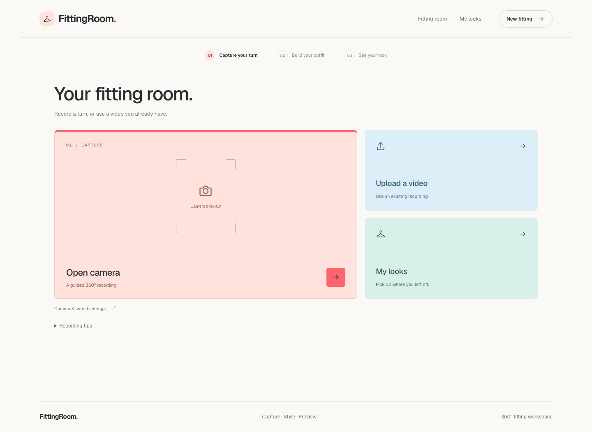

# FittingRoom

A virtual fitting room: record a full turn, choose a top and bottoms from Shopify stores, and view your outfit in 360° with a smooth video.



## Run locally

The full local pipeline currently requires **macOS on Apple Silicon**, Node.js 24+, Python 3.12, and ffmpeg. SAM 3 uses MLX on the Apple GPU.

```bash
brew install node python@3.12 ffmpeg
cd tryon-app
cp ../.env.example .env.local
# Fill in OPENAI_KEY and GEMINI_API_KEY in .env.local.
npm ci
npm run setup:python
npm run dev -- --port 3100
```

Open <http://localhost:3100>. Keep the terminal open; Ctrl+C stops the website and Python service together. Python setup downloads the SAM model weights once (about 1 GB).

For a production preview:

```bash
cd tryon-app
npm run build
npm start -- --port 3100
```

If Turbopack cannot bind a port in your execution environment, build with `npm run build -- --webpack`.

## Configuration

Keys belong only in `tryon-app/.env.local`. That file is ignored by Git. Both providers require API billing/credits and access to the configured models; see [the environment template](.env.example).

Add Shopify stores as a comma-separated list:

```env
SHOPIFY_STORE_URLS=https://gymsharkusa.myshopify.com,https://kith.com,https://www.aloyoga.com
```

Restart the app and open the outfit page. Stores are validated, imported, and tagged automatically. Completed catalogs are reused. The public Shopify product feed requires no Shopify API key.

## What is included

- `tryon-app/`: Next.js frontend/API and Python local-model service.
- `scripts/` and `web/`: the original prototype utilities and viewer.
- `inputs/`: example product images and a studio background.
- `docs/`: project notes, references, and UI previews.

API keys, recordings, runtime catalogs, generated videos, dependency folders, and downloaded weights stay local. The optional sample video is excluded too: to enable **Try a sample**, supply your own `IMG_8204.mov` in this directory, or use the upload/recording flow.

## Validation

```bash
cd tryon-app
npm run typecheck
npm run build -- --webpack
```

Next.js generates route types during build/dev, so build first if type checking a completely fresh checkout reports missing route helpers. See [the app README](tryon-app/README.md) for architecture, API routes, and verification details.
